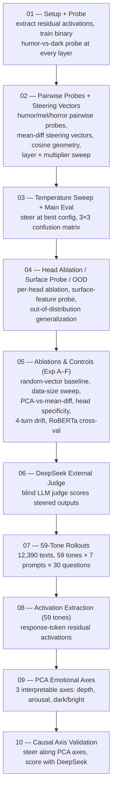

# Emotional Tone Geometry in LLM Residual Streams

We test whether humor, melancholy, and horror are encoded as linearly separable, geometrically structured directions in the residual streams of transformer LLMs, whether that structure matches Russell's circumplex model of affect, and whether it replicates across three independently-trained models: **Qwen3-4B**, **Llama-3.2-3B**, **Gemma-3-4b-it**.

Same 10-script pipeline, same dataset, run independently per model.

---

## Pipeline



Scripts 01–06 are the main-paper pipeline (3 emotions). Scripts 07–10 extend to 59 emotional tones (appendix).

---

## Results

### Script 01 — Probe Accuracy

| Model | Probe layer (N−2) | Probe layer acc | Best layer | Best layer acc |
|---|---|---|---|---|
| Qwen3-4B | L34 / 36 | 0.9650 | L33 | 0.9675 |
| Llama-3.2-3B | L26 / 28 | 0.9700 | L26 | 0.9700 |
| Gemma-3-4b-it | L32 / 34 | 0.9625 | L17 | 0.9700 |

### Script 02 — Pairwise Probes + Steering Vector Geometry

**Pairwise probe CV accuracy**

| Model | humor vs mel | humor vs horror | mel vs horror |
|---|---|---|---|
| Qwen3-4B | 0.9750 | 0.9625 | 0.9600 |
| Llama-3.2-3B | 0.9750 | 0.9725 | 0.9600 |
| Gemma-3-4b-it | 0.9775 | 0.9675 | 0.9650 |

**Steering vector cosine similarities**

| Model | cos(humor, mel) | cos(humor, horror) | cos(mel, horror) |
|---|---|---|---|
| Qwen3-4B | −1.0000 | −0.5017 | +0.5017 |
| Llama-3.2-3B | −1.0000 | −0.5611 | +0.5611 |
| Gemma-3-4b-it | −1.0000 | −0.5350 | +0.5350 |

**Best steering configs (layer × multiplier, both-rate from sweep)**

| Model | humor | melancholy | horror |
|---|---|---|---|
| Qwen3-4B | L23 × 12.0 (100%) | L2 × 6.0 (80%) | L17 × 15.0 (93.3%) |
| Llama-3.2-3B | L19 × 15.0 (100%) | L19 × 15.0 (100%) | L21 × 15.0 (100%) |
| Gemma-3-4b-it | L29 × 6.0 (66.7%) | L0 × 12.0 (66.7%) | L0 × 15.0 (73.3%) |

*Note: Gemma's melancholy/horror sweeps only tested 3 layers each ({0,33,3} and {0,33,2} respectively) — L0 is the best within the tested set, not confirmed globally optimal.*

### Script 03 — Temperature Sweep + Main Evaluation (100-sample eval)

| Model | Best temp | Confusion diagonal |
|---|---|---|
| Qwen3-4B | 0.5 | 78.3% |
| Llama-3.2-3B | 0.0 | 100% |
| Gemma-3-4b-it | 0.2 | 74.3% |

**Per-emotion (both-rate / pred accuracy / coherent / mean shift)**

| Model | Humor | Melancholy | Horror |
|---|---|---|---|
| Qwen3-4B | 98% / 89% / 100% / +41.23 | 64% / 99% / 98% / +10.61 | 89% / 47% / 99% / +25.03 |
| Llama-3.2-3B | 81% / 100% / 81% / +22.95 | 90% / 100% / 90% / +21.72 | 94% / 100% / 94% / +20.22 |
| Gemma-3-4b-it | 54% / 50% / 54% / +1721.96 | 52% / 76% / 58% / +608.29 | 49% / 97% / 52% / +807.18 |

### Script 04a — Confusion Bleed (Three-Pole Geometry)

| Model | mel↔horror bleed | humor↔other bleed | bleed ratio |
|---|---|---|---|
| Qwen3-4B | 0.270 | 0.0275 | 9.82 |
| Llama-3.2-3B | 0.0 | 0.0 | 0.0 |
| Gemma-3-4b-it | 0.135 | 0.125 | 1.08 |

### Script 04b — Surface vs. Activation Probe

| Model | Surface probe acc | Activation probe acc | Gap |
|---|---|---|---|
| Qwen3-4B | 0.71 | 0.7833 | +0.0733 |
| Llama-3.2-3B | 0.71 | 1.00 | +0.29 |
| Gemma-3-4b-it | 0.71 | 0.7433 | +0.0333 |

### Script 04c — Head Ablation

| Model | Layers tested | Heads/layer | Critical heads found |
|---|---|---|---|
| Qwen3-4B | 0, 2, 9, 17, 18, 23, 34 | 32 | 0 |
| Llama-3.2-3B | 0, 7, 14, 19, 21, 26 | 24 | 10 (9 of 10 at L0/L7) |
| Gemma-3-4b-it | 0, 8, 17, 29, 32 | 8 | 1 (L17 H0, drop=0.090) |

### Script 04d — Out-of-Distribution Generalization

| Model | In-dist acc | humor OOD | mel OOD | horror OOD |
|---|---|---|---|---|
| Qwen3-4B | 0.71 | 9% | 2% | 64.5% |
| Llama-3.2-3B | 0.7317 | 9% | 2% | 64.5% |
| Gemma-3-4b-it | 0.71 | 9% | 2% | 64.5% |

*(Surface-lexical-feature classifier evaluated on fixed external datasets — model-agnostic by construction, hence identical sub-scores.)*

### Script 05 — Ablations & Controls

**Exp A — learned vector vs. random baselines (both-rate)**

| Model | Emotion | our_vec | random_101 | random_202 | random_303 |
|---|---|---|---|---|---|
| Qwen3-4B | humor | 0.867 | 0.200 | 0.267 | 0.533 |
| Qwen3-4B | melancholy | 0.733 | 0.533 | 0.467 | 0.600 |
| Qwen3-4B | horror | 0.867 | 0.467 | 0.133 | 0.400 |
| Llama-3.2-3B | humor | 0.733 | 0.267 | 0.467 | 0.333 |
| Llama-3.2-3B | melancholy | 0.667 | 0.467 | 0.400 | 0.467 |
| Llama-3.2-3B | horror | 0.733 | 0.467 | 0.267 | 0.467 |
| Gemma-3-4b-it | humor | 0.333 | 0.267 | 0.333 | 0.000 |
| Gemma-3-4b-it | melancholy | 0.467 | 0.267 | 0.333 | 0.267 |
| Gemma-3-4b-it | horror | 0.667 | 0.067 | 0.467 | 0.400 |

**Exp B — data-size ablation (both-rate by n)**

| Model | n=25 | n=50 | n=100 | n=150 | n=200 |
|---|---|---|---|---|---|
| Qwen3-4B | 86.7% | 93.3% | 93.3% | 100% | 90.0% |
| Llama-3.2-3B | 80.0% | 93.3% | 86.7% | 93.3% | 86.7% |
| Gemma-3-4b-it | 26.7% | 0.0% | 26.7% | 13.3% | 3.3% |

*Note: Gemma's both-rate trends toward 0% as n increases, opposite of the expected direction — no stable plateau, unlike Qwen/Llama.*

**Exp C — RepE PCA vector vs. mean-diff vector**

| Model | cos(PCA, mean-diff) | cos(mean-diff, probe) |
|---|---|---|
| Qwen3-4B | +0.0864 | +0.7929 |
| Llama-3.2-3B | +0.6918 | +0.8043 |
| Gemma-3-4b-it | −0.6697 | +0.6869 |

*Note: cos(PCA, mean-diff) changes sign across all three models (+0.09 / +0.69 / −0.67) — no consistent relationship.*

**Exp D — head ablation specificity control**

| Model | SV-agreement baseline acc | Mean specificity |
|---|---|---|
| Qwen3-4B | 0.50 | 0.0 (0 critical heads to test) |
| Llama-3.2-3B | 0.60 | −0.007 |
| Gemma-3-4b-it | 0.60 | +0.090 |

**Exp E — 4-turn tonal drift (horror), mean horror score by turn**

| Model | T1 | T2 | T3 | T4 |
|---|---|---|---|---|
| Qwen3-4B | +23.16 | +13.94 | +19.60 | +11.94 |
| Llama-3.2-3B | +2.74 | +2.50 | +1.26 | +0.58 |
| Gemma-3-4b-it | +2006.57 | +2077.06 | +1807.03 | +1829.96 |

**Task 6 — tonal drift (T1 vs T2, statistical test; Qwen only, separate script from Exp E)**

| Model | mean T1 | mean T2 | mean drift | t-stat | p | % neutralized |
|---|---|---|---|---|---|---|
| Qwen3-4B | 25.31 | 21.37 | 3.94 | 1.02 | 0.315 (ns) | 56.7% |

**Exp F — DistilRoBERTa cross-validation (Spearman r, p, RoBERTa acc)**

| Model | Humor | Melancholy | Horror |
|---|---|---|---|
| Qwen3-4B | r=−0.057, p=.575 (ns), 12% | r=+0.090, p=.371 (ns), 33% | r=+0.242, p=.0153 (sig), 29% |
| Llama-3.2-3B | r=−0.069, p=.497 (ns), 23% | r=+0.036, p=.721 (ns), 41% | r=−0.053, p=.598 (ns), 36% |
| Gemma-3-4b-it | r=−0.073, p=.471 (ns), 7% | r=+0.077, p=.445 (ns), 19% | r=+0.300, p=.0024 (sig), 20% |

### Script 06 — DeepSeek External Judge

| Model | Overall acc | Humor acc | Melancholy acc | Horror acc |
|---|---|---|---|---|
| Qwen3-4B | 58.7% | 64% | 92% | 20% |
| Llama-3.2-3B | 63.0% | 71% | 91% | 27% |
| Gemma-3-4b-it | 50.7% | 64% | 69% | 19% |

**Mean DeepSeek scores for horror-targeted generations (1–5 scale)**

| Model | humor score | melancholy score | horror score |
|---|---|---|---|
| Qwen3-4B | 1.07 | 2.60 | 1.95 |
| Llama-3.2-3B | 1.01 | 2.85 | 2.16 |
| Gemma-3-4b-it | 1.05 | 2.33 | 1.78 |

### Script 09 — PCA Emotional Axes (59-tone space)

**Variance explained**

| Model | Depth (PC1) | Arousal (PC2) | Dark/Bright (PC3) |
|---|---|---|---|
| Qwen3-4B | 27.8% | 18.7% | 14.7% |
| Llama-3.2-3B | 23.3% | 19.9% | 16.4% |
| Gemma-3-4b-it | 27.4% | 13.4% | 11.5% |

**Pole coordinates (depth, arousal, dark/bright)**

| Model | Humor | Melancholy | Horror |
|---|---|---|---|
| Qwen3-4B | (−47.5, −20.0, −56.2) | (+48.8, +9.4, +14.6) | (−4.3, −1.5, +40.6) |
| Llama-3.2-3B | (−4.49, +0.15, −2.70) | (+3.96, −1.08, +1.56) | (+0.60, +1.44, +3.71) |
| Gemma-3-4b-it | (−3570.4, −9.2, −1393.0) | (+1917.1, −705.9, +8.4) | (+1292.4, +666.1, +1394.6) |

*Note: raw PCA magnitudes are not comparable across models (tens vs. thousands) — axes are computed independently per model.*

### Script 10 — Causal PCA-Axis Steering Validation

| Model | Axis | Baseline | Pos max | Neg mean |
|---|---|---|---|---|
| Qwen3-4B | depth | 56.5 | 31.5 | 48.7 |
| Qwen3-4B | arousal | 35.5 | 47.0 | 22.3 |
| Qwen3-4B | dark/bright | 28.5 | 39.0 | 17.0 |
| Llama-3.2-3B | depth | 24.0 | 56.5 | 62.7 |
| Llama-3.2-3B | arousal | 30.5 | 99.0 | 26.2 |
| Llama-3.2-3B | dark/bright | 26.0 | 32.5 | 16.0 |
| Gemma-3-4b-it | depth | 0.0 | 0.0 | 76.7 |
| Gemma-3-4b-it | arousal | 3.0 | 12.0 | 24.0 |
| Gemma-3-4b-it | dark/bright | 4.0 | 4.0 | 2.0 |

---

## Repo Structure

```
Emotional-Tone-Geometry-in-LLM-Residual-Streams/
├── README.md                 (this file)
├── data/                     (shared 600-sample dataset: 200 humor / 200 melancholy / 200 horror)
├── llama/
│   ├── scripts/              (10-script pipeline, meta-llama/Llama-3.2-3B)
│   ├── results/              (JSON/CSV outputs + manifest README)
│   └── figures/              (plots, confusion matrices, sweep heatmaps)
├── qwen/
│   ├── scripts/              (10-script pipeline, Qwen/Qwen3-4B)
│   ├── results/
│   └── figures/
└── gemma/
    ├── scripts/              (10-script pipeline, google/gemma-3-4b-it)
    ├── results/
    └── figures/
```
